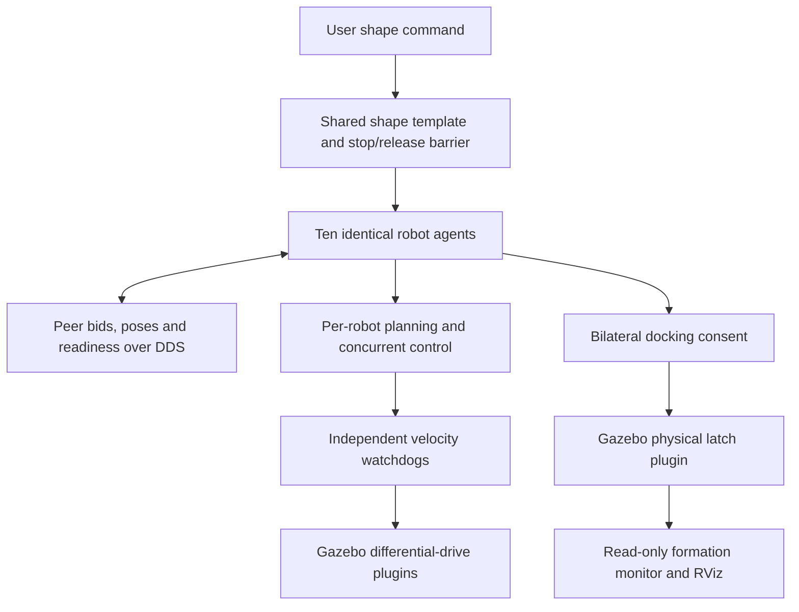

# Swarm robot simulation: connected shape formation

A ROS 2 Humble workspace for experimenting with compact differential-drive
robots in Gazebo Classic 11. The main demo runs **ten robots** that exchange
bids, choose shape roles, move concurrently, and physically connect into a
LINE, CIRCLE or approximate SQUARE. Sending a different shape stops the fleet,
disconnects the current assembly, and starts formation from the current poses.

The robot uses primitive geometry, ideal wheel feedback, an IMU, a three-ray
front distance scanner, and optional front/rear docking connectors. This is a
planar simulation testbed for future swarm hardware; no detailed CAD meshes
are required to run it.

## Packages

| Package and guide | What it does |
| --- | --- |
| [swarm_robot_description](src/swarm_robot_description/README.md) | Shared 100 mm chassis, wheels/caster, sensors, docking geometry, namespaced TF, single-robot spawn and RViz launches. |
| [swarm_robot_behaviors](src/swarm_robot_behaviors/README.md) | Earlier five-robot leader/follower experiment: waypoint leader, proportional following, front-range stop/turn override. |
| [swarm_robot_docking](src/swarm_robot_docking/README.md) | Earlier five-robot pairing demo: robot-computed bids, centralized pair selection, peer-relative rendezvous, logical docking. Also supplies reusable random placement and environment reset. |
| [swarm_robot_shape_formation](src/swarm_robot_shape_formation/README.md) | Main ten-robot demo: shape templates, distributed role auction, local planning, concurrent assembly, docking consent, watchdogs, monitoring and automatic shape changes. |
| [swarm_robot_dock_physics](src/swarm_robot_dock_physics/README.md) | C++ Gazebo world plugin that creates real simulation joints between consenting nearby ports and releases them during transitions/reset. |

The shape demo reuses the description, pose/control helpers and reset utilities
from the earlier packages. The earlier demos remain independently runnable.
`model_part_files/` contains physical design material; it is not required by
these simulation launches. `build/`, `install/` and `log/` are generated locally.

## Supported environment

- Ubuntu **22.04**, with the existing validation performed on amd64.
- ROS **2 Humble**, Python 3.10, colcon and rosdep.
- **Gazebo Classic 11**, `gazebo_ros_pkgs` and Gazebo development headers.
- Xacro, robot_state_publisher, RViz2, PyYAML and nlohmann JSON for the C++ plugin.

Install ROS 2 Humble using the [official Ubuntu installation guide](https://docs.ros.org/en/humble/Installation/Ubuntu-Install-Debs.html)
first, including its apt repository configuration. This workspace uses Classic
plugins; it does not run unchanged on modern Gazebo. Gazebo Classic reached
end of life in January 2025; the version choice here preserves the existing
Humble/Classic experiment. See the [Classic ROS integration documentation](https://classic.gazebosim.org/tutorials?cat=connect_ros&tut=ros2_installing).

No `ros2_control` controller manager is needed: wheel commands use
`libgazebo_ros_diff_drive.so`. There are no external mesh/model downloads.

## Clone, install dependencies and build

Replace `YOUR_REPOSITORY_URL` with this repository's GitHub clone URL. Clone
the repository as the workspace root, rather than nesting it inside another
workspace's `src/` directory:

```bash
sudo apt update
sudo apt install -y git
mkdir -p ~/robotics/projects
cd ~/robotics/projects
git clone YOUR_REPOSITORY_URL Swarm_robot
cd Swarm_robot

source /opt/ros/humble/setup.bash
sudo apt install -y build-essential cmake python3-colcon-common-extensions \
  python3-rosdep python3-pytest python3-yaml nlohmann-json3-dev \
  gazebo libgazebo-dev ros-humble-gazebo-ros-pkgs ros-humble-gazebo-dev \
  ros-humble-xacro ros-humble-robot-state-publisher ros-humble-rviz2

# Only on a machine where rosdep has not been initialized before:
sudo rosdep init
rosdep update
rosdep install --from-paths src --ignore-src -r -y --rosdistro humble

colcon build --symlink-install
source install/setup.bash
```

Skip `sudo rosdep init` if `/etc/ros/rosdep/sources.list.d/20-default.list`
already exists. Package manifests declare the remaining ROS dependencies.
The commands above require Ubuntu and ROS apt repositories; a fresh dependency
download on another machine has not been verified by the local build checks.

## Run the ten-robot demo

In terminal 1, stop any earlier demo on the same ROS domain/Gazebo master, then:

```bash
source /opt/ros/humble/setup.bash
cd ~/robotics/projects/Swarm_robot
source install/setup.bash
ros2 launch swarm_robot_shape_formation ten_robot_shape_demo.launch.py
```

Gazebo and RViz open; all robots initially wait for a shape command. Random
spawns keep robot centers at least 0.8 m apart and 0.5 m from the arena walls.
Add `spawn_seed:=0` to reproduce a layout, or `gui:=false rviz:=false` for a
headless run. The default seed `-1` selects a new layout each launch.

In terminal 2, source the workspace and match the demo's Fast DDS UDP profile:

```bash
source /opt/ros/humble/setup.bash
source ~/robotics/projects/Swarm_robot/install/setup.bash
shape_share=$(ros2 pkg prefix --share swarm_robot_shape_formation)
export FASTRTPS_DEFAULT_PROFILES_FILE="$shape_share/config/fastdds_udp.xml"

ros2 topic pub --once --keep-alive 2 --qos-durability volatile \
  /swarm/shape_command std_msgs/msg/String "{data: 'CIRCLE'}"
```

The two-second keep-alive allows one-shot discovery/delivery under load. Use
the same sourcing, DDS profile, and any isolation exports in every CLI terminal.

```bash
# Wait for status COMPLETE, then change shape without resetting:
ros2 topic echo /swarm/formation_status std_msgs/msg/String --qos-durability transient_local
# Ctrl+C ends the status viewer. Publish the next command:
ros2 topic pub --once --keep-alive 2 /swarm/shape_command std_msgs/msg/String "{data: 'SQUARE'}"
ros2 topic pub --once --keep-alive 2 /swarm/shape_command std_msgs/msg/String "{data: 'LINE'}"

# Stop where the robots are; existing joints remain latched:
ros2 topic pub --once --keep-alive 2 /swarm/shape_command std_msgs/msg/String "{data: 'STOP'}"

# Explicit arena reset: release joints, restore this launch's sampled poses:
ros2 service call /swarm/reset std_srvs/srv/Trigger '{}'
```

Let each shape complete before requesting the next when comparing formations.
A request during a transition replaces the pending shape with the latest one.
Repeating the active shape is idempotent. A failed stop/release confirmation
keeps robots held and reports `TRANSITION_FAILED`; inspect the status before retrying.

LINE uses nine physical bonds; CIRCLE and SQUARE use ten, including the closing
bond. The circle is a ten-sided polygon. The square has two opposite chamfered
corners because ten equal connector segments cannot tile four equal straight
sides. Completion checks the actual connected graph and permits up to 5 cm
position and 0.25 rad heading error per role.

## What runs on the robots, and what is shared?



The role auction is distributed: there is no central auctioneer choosing which
robot occupies each role. The shared task node supplies anonymous points and
coordinates stop/release between shapes. Robots compute their own bids, paths,
and velocity commands. This is a hybrid architecture with a common world frame,
known membership, all-to-all communication and Gazebo ground-truth poses.
It is not yet a local-sensing-only, fully decentralized swarm.

The physical ESP32-S3/TB6612/N20 control loop is represented by the Gazebo drive
plugin. Wheel joint states provide ideal encoder positions/velocities; odometry
is world ground truth, not encoder integration. ROS 2 DDS represents inter-robot
Wi-Fi message exchange without a radio propagation model. IMU and range topics
are available; formation planning currently uses shared ground-truth poses.

## Inspect robot and docking state

| Interface | Meaning |
| --- | --- |
| `/swarm/formation_status` | Shape phase, assignment, simultaneous movers, errors and connection graph. |
| `/swarm/shape_request_status` | Acceptance or rejection of a shape request. |
| `/swarm/dock_status` | Physics plugin's actual joints and reasons a pending capture cannot latch. |
| `/robot_N/shape/peer_state` | Each robot's bids, phase, pose and motion intent. |
| `/robot_N/joint_states` | Wheel positions in radians and velocities in radians/second. |
| `/robot_N/odom` | Gazebo world-pose odometry. |
| `/robot_N/imu/data` | Orientation, angular velocity and linear acceleration. |
| `/robot_N/range/front` | Three-beam `sensor_msgs/msg/LaserScan`, including infinite no-return values. |

```bash
ros2 topic list
ros2 topic echo /swarm/dock_status --once --qos-durability transient_local
ros2 topic echo /robot_1/joint_states --once
ros2 topic echo /robot_1/odom --once
ros2 topic echo /robot_1/imu/data --once --qos-reliability best_effort
ros2 topic echo /robot_1/range/front --once --qos-reliability best_effort
ros2 run tf2_ros tf2_echo world robot_1/front_dock_frame
```

Each robot has a unique frame prefix:
`world -> robot_N/odom -> robot_N/base_footprint -> robot_N/base_link`,
with wheel, caster, IMU, range and docking descendants. Physical bonds are
reported separately so a closed ring does not create a cyclic TF tree.
RViz shows the models, TF, odometry and formation markers.

The formation watchdog owns `/robot_N/cmd_vel`; use the single-robot demo for
manual driving instead of publishing competing commands during formation.

## Other demos

Run one demo at a time on the default domain/master:

```bash
# One robot: manual /cmd_vel driving and sensor inspection
ros2 launch swarm_robot_description sim.launch.py rviz:=true

# Five robots: waypoint leader and four followers
ros2 launch swarm_robot_behaviors five_robot_leader_follow.launch.py

# Five robots: logical pairing with a centralized allocator
ros2 launch swarm_robot_docking five_robot_docking_demo.launch.py
ros2 topic pub --once --keep-alive 2 /swarm/pair_count std_msgs/msg/Int32 '{data: 2}'
```

See each package guide for its controls and limits. Pair count requests belong
to the five-robot pairing demo; shape names belong to the ten-robot demo.

## Validation and troubleshooting

```bash
colcon test
colcon test-result --verbose
```

For live integration checks, use a dedicated domain and Gazebo master. Export
these values in **both** the launch and verification terminals, choosing values
not already used by another experiment:

```bash
export ROS_DOMAIN_ID=91
export GAZEBO_MASTER_URI=http://127.0.0.1:11391
# Launch a fresh ten-robot demo after these exports, then in the test terminal:
python3 src/swarm_robot_shape_formation/test/verify_live.py \
  --shapes CIRCLE SQUARE LINE CIRCLE --reconfigure \
  --report-path /tmp/connected-shapes.json
```

The verifier moves and resets its test fleet. A separate
`test/verify_latch_physics.py` in the shape package tests bilateral consent,
invalid capture rejection, actual constraint behavior and release.
Package READMEs explain the optional fault tests.

The implementation was locally validated with 114 reported automated tests
and a live CIRCLE → SQUARE → LINE → CIRCLE sequence. This documents a tested
experiment, not a guarantee of convergence or collision avoidance for every
random layout. Logs are generated locally and are not required for reproduction.

If CLI tools see no topics, check workspace sourcing, `ROS_DOMAIN_ID`, the DDS
profile and whether Gazebo is running/unpaused. If the docking plugin cannot
load, rebuild all five packages and source `install/setup.bash` in the launch
terminal. If GUI startup from a Snap terminal fails with GTK/GIO errors, try:

```bash
env -u GTK_PATH -u GIO_MODULE_DIR \
  ros2 launch swarm_robot_shape_formation ten_robot_shape_demo.launch.py
```

Do not use Gazebo's GUI reset as a substitute for `/swarm/reset`; the service
coordinates controller state and physical joints without rewinding `/clock`.

## Scope and references

Current work covers planar connected formation and reconfiguration. It does
not include 3D assembly, SLAM, Nav2, real relative localization, realistic radio
loss, encoder quantization, battery/motor electrical models or hardware docking
validation. The connectors are ideal simulation capture latches with fixed
joints; they are not detailed magnetic/contact or freely hinged mechanisms.

Each package README links original papers and explains whether a reference is
an algorithmic basis, conceptual inspiration or a software platform citation.
For the role auction, see Choi, Brunet and How's
[consensus-based decentralized auctions paper](https://dspace.mit.edu/entities/publication/b0bf0a05-be3b-433b-9f4b-ce314ed5178b).
The current implementation is a simplified single-role CBAA-style auction;
it does not implement full multi-task CBBA or inherit all of that paper's guarantees.

## License metadata

The behavior, pairing, shape formation and physics package manifests declare
Apache-2.0. The description package still has an unresolved license declaration,
and this workspace has no root license file. A repository-wide license must be
chosen and the remaining declaration resolved before presenting the entire
repository as consistently licensed open-source software.
